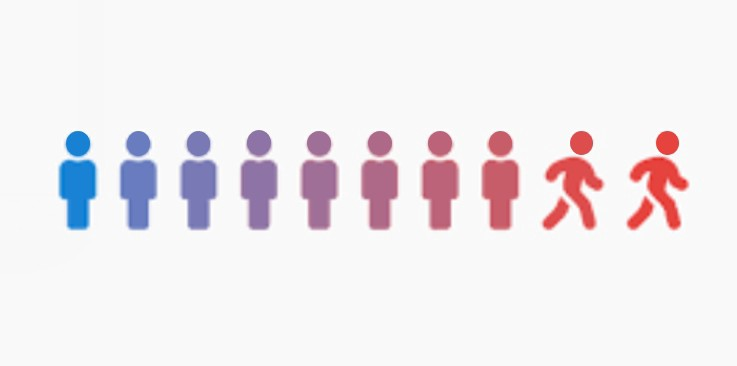
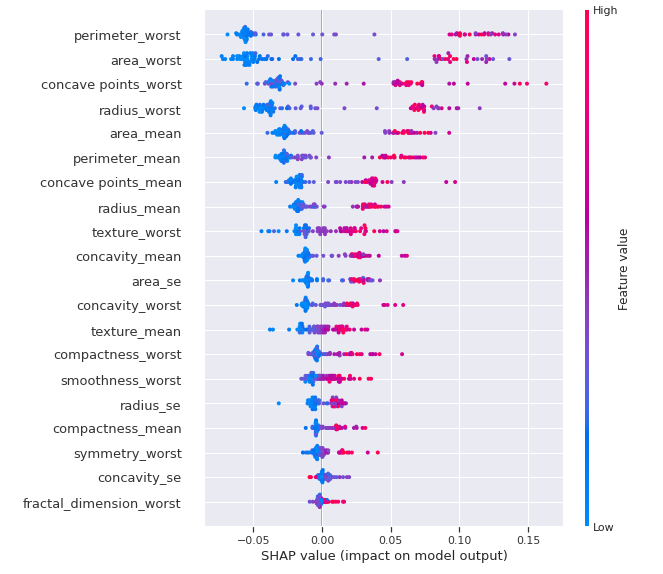
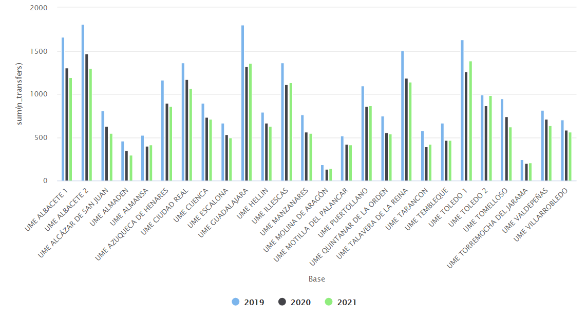
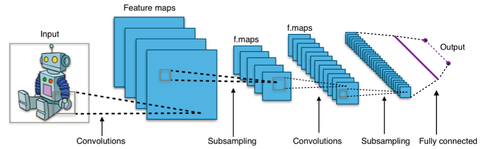
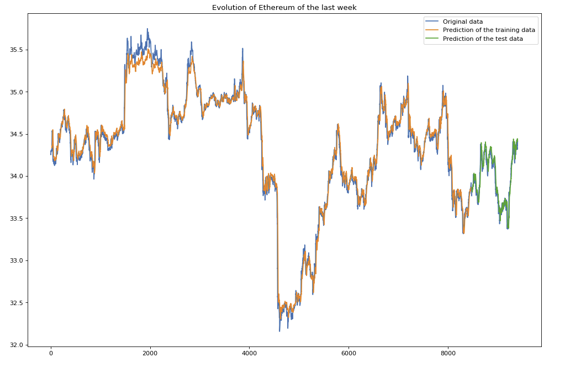

# Gonzalo Díaz Amor
### Data Scientist & AI Engineer

Hi! I'm Gonzalo, a Data Scientist and AI Engineer with a background in statistics. I focus on evaluating LLMs rigorously: LLM-as-a-Judge, statistical validation and post-training studies that report what actually held up. I also build end-to-end machine learning systems, from RAG and agentic pipelines to classical ML and explainable AI. Below is a selection of my personal and academic projects.

📄 [CV](https://github.com/gondiam/cv/raw/main/output/CV_Gonzalo_DiazAmor_EN.pdf) · 💼 [LinkedIn](https://www.linkedin.com/in/gdiazamor/) · 🐙 [GitHub](https://github.com/gondiam) · ✉️ [Email](mailto:gdiazamor.ds@gmail.com)

## Featured Projects

# [llm-judge-stats: Can This LLM Judge Be Trusted?](https://github.com/gondiam/llm-judge-stats)
Open-source Python package with the statistics to check whether an LLM judge can be trusted.

* Cohen's/Fleiss' kappa, ICC, F1/MCC with bootstrap CIs, sample-size planning and position-bias shuffling, with tests validated against published values
* Applied to the public MT-Bench human judgments (1,814 items): GPT-4 vs. human-majority kappa = 0.51 (95% CI 0.47-0.54), on par with the human-human kappa of 0.50
* The same data gives kappa = 0.38 under a different label order, so two kappas are comparable only with the same layout
* 15.8% of verdicts were position-inconsistent

# [sft-dpo-eval: Did Each Training Stage Beat the Noise?](https://github.com/gondiam/sft-dpo-eval)
A preregistered post-training study: the analysis was committed before any training run.

* Fine-tuned Qwen3-1.7B with SFT and then DPO (LoRA, TRL) on PubMedQA across 3 seeds, on a free Kaggle T4
* Paired comparisons with 95% CIs and Holm correction, using llm-judge-stats
* Result: SFT raised accuracy from 38.6% to 71.7% (+33.1 points, 95% CI 27.4-38.9). DPO added no improvement (-1.0 point) and is reported as a null result
* What got worse: about 7 points of MMLU, mostly from repetition loops rather than lost knowledge (exploratory reading)

## Earlier Projects

# [RAG vs. Open Knowledge Format (OKF) vs. Both Combined](https://github.com/gondiam/rag-vs-okf)
Inspired by [a benchmark video by Joaquín Ruiz](https://github.com/JoaquinRuiz/rag-vs-okf) — this is my own build, not a reproduction: original synthetic company corpus, original eval questions, original code.

* Built three pipelines over the same 14-document synthetic knowledge base: classic RAG (chunking + `nomic-embed-text` embeddings + ChromaDB), an OKF agent that navigates a bundle of curated Markdown concepts instead of retrieving chunks, and a hybrid of both
* Everything runs locally via Ollama (`ornith:9b` generation), no external API calls
* Designed the corpus with deliberate traps: two unit-conversion gotchas (EUR/month/seat → annualized USD; TB → pooled GB) and one metric that doesn't exist anywhere in the corpus, to test for hallucination
* Result on 6 eval questions: **RAG 5/6, OKF 4/6, RAG+OKF 6/6** — including a case where OKF hallucinated a number reasoning beyond its curated content, and a case where only the hybrid setup caught a contradiction between two source documents. Full breakdown, including *where and why* each approach failed, in [`results/RESULTS.md`](https://github.com/gondiam/rag-vs-okf/blob/main/results/RESULTS.md)

# [Churn Customers Prediction](https://github.com/gondiam/Churn_prediction)
* An Exploratory Data Analysis (EDA) was performed to understand the data and compare between groups of the population
* Comparing groups by graphs: density and boxplot for real variables, barplot otherwise
* Resampling and feature engineering were important due to the imbalanced dataset
* At the end an XGBoost model was used for classification, with GridSearch to tune hyperparameters and improve performance

# [Breast Cancer Detection using Random Forest](https://github.com/gondiam/gondiam/blob/main/GDA_Explainable_AI_Graded_Hands_on_Exercise.ipynb)
(recommended to open in colab)

Breast cancer is a type of cancer that starts in the breast. Cancer starts when cells begin to grow out of control. Breast cancer cells usually form a tumor that can often be seen on an x-ray or felt as a lump. Breast cancer occurs almost entirely in women, but men can get breast cancer, too. A benign tumor is a tumor that does not invade its surrounding tissue or spread around the body. A malignant tumor is a tumor that may invade its surrounding tissue or spread around the body.

In this project I develop a random forest solution with an emphasis on using SHAP (SHapley Additive exPlanations), a unified approach to explain the output of any machine learning model.
[SHAP explanation](https://shap.readthedocs.io/en/latest/index.html)

# [Exploratory Data Analysis: Personal Key Indicators of Heart Disease](https://github.com/gondiam/gondiam/blob/main/Heart_Disease.ipynb)
Take a look at the Kaggle URL where you can download the [data](https://www.kaggle.com/datasets/kamilpytlak/personal-key-indicators-of-heart-disease).
According to the CDC, heart disease is one of the leading causes of death for people of most races in the US (African Americans, American Indians and Alaska Natives, and white people). About half of all Americans (47%) have at least 1 of 3 key risk factors for heart disease: high blood pressure, high cholesterol, and smoking. Other key indicators include diabetic status, obesity (high BMI), not getting enough physical activity, or drinking too much alcohol. Detecting and preventing the factors that have the greatest impact on heart disease is very important in healthcare. Computational developments, in turn, allow the application of machine learning methods to detect "patterns" from the data that can predict a patient's condition.

# [ICU Transfers 2019-2021](https://github.com/gondiam/visualization_timeseries)
* Using the highcharter library, I developed a time-series visualization of ICU transfers for a region of Spain
* Interactive comparison between periods across more than 20 hospital bases
* A summary of different parameters per base
* A boxplot to visualize the distribution of transfer records overall and per year
* Total number of transfers per year and base

## Academic & Bootcamp Projects

# [DPhi Bootcamp — Gender Determination by Morphometry of Eyes](https://github.com/gondiam/gondiam/blob/main/bootcampdphi_def_GDA.py)
Problem Statement

The anthropometric analysis of the human face is an essential study for performing craniofacial plastic and reconstructive surgeries.
Facial anthropometrics are affected by various factors such as age, gender, ethnicity, socioeconomic status, environment, and region.

The objective was to build a model to scan the image of a patient's eye and determine gender.

A deep learning model using TensorFlow and Keras achieved 92.4512% correctly labeled images in the competition, ranking 37th out of 91.

# [Ethereum Price Forecasting with an LSTM Neural Network](https://github.com/gondiam/gondiam/blob/main/LSTM_loockback_1.ipynb)
Problem Statement

Cryptocurrency price volatility is one of the main challenges in financial time-series forecasting.

The objective was to explore how far a sequence model could go on this problem, using a Long Short-Term Memory (LSTM) network — a type of recurrent neural network suited to sequence dependence, capable of training successfully on very large architectures.

The model achieved a Root Mean Squared Error (RMSE) of 0.1 on the held-out test period. As with any short-horizon price forecast, this is best read as a modeling exercise rather than a trading-ready system.

**Thank you for the visit :)**
